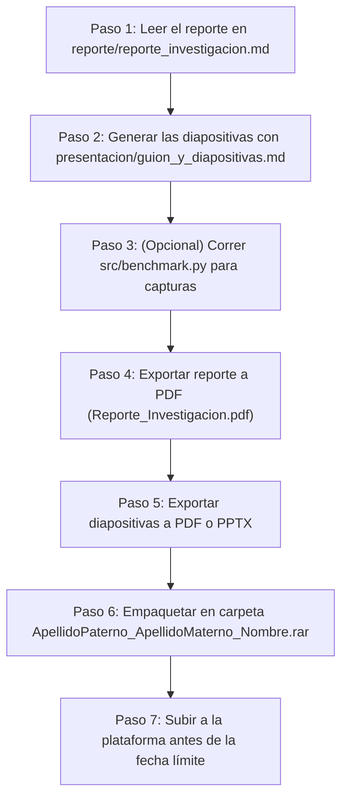

# Plan Maestro de Trabajo: Proyecto en Equipo
## Trabajo de Investigación y Exposición — Análisis y Diseño de Algoritmos

> **Problema Seleccionado:** El Problema del Fontanero Diligente (*Single-Machine Scheduling / Minimización del Tiempo de Espera*)  
> **Docente:** Mtra. Irene Olaya Ayaquica Martínez  
> **Integrantes:**  
> • **Dante Castelán Carpinteyro** (Matrícula: 202320271)  
> • **Yoshua Rameli Adán Pérez**  
> **Ponderación:** 30% de la calificación final (20% Reporte escrito + 10% Exposición oral)  
> **Objetivo del documento:** Organizar el flujo de trabajo colaborativo para que el proyecto quede completamente estructurado por Dante y pueda ser culminado y empaquetado fluidamente por Yoshua.

---

## 1. División Estratégica de Roles

Para garantizar una colaboración equitativa y eficiente, el trabajo se divide en dos fases sincronizadas:

| Integrante | Rol Principal | Responsabilidades Clave |
|---|---|---|
| **Dante Castelán Carpinteyro** (Mat. 202320271) | **Arranque Teórico & Arquitectura** | • Selección y justificación del problema (El Fontanero Diligente).<br>• Formalización matemática y análisis de técnicas de diseño.<br>• Deducción matemática exhaustiva de complejidades ($O, \Theta$).<br>• Demostración formal de optimalidad voraz (SPT) y análisis de clases de complejidad ($P$ y $NP$).<br>• Redacción del borrador maestro del reporte (`reporte_investigacion.md`).<br>• Implementación de algoritmos de referencia en Python (`src/`). |
| **Yoshua Rameli Adán Pérez** | **Visualización, Pruebas & Entrega** | • Revisión y validación del reporte de investigación.<br>• Creación del archivo de presentación (PowerPoint, Canva, Google Slides o LaTeX Beamer) usando el guion provisto (`guion_y_diapositivas.md`).<br>• Ejecución del script de pruebas empíricas y generación de gráficos/tablas de soporte.<br>• Generación del archivo final en formato PDF del reporte.<br>• Empaquetado estricto en formato `.rar` / `.zip` con la nomenclatura oficial solicitada. |

---

## 2. Matriz RACI de Actividades

* **R (Responsable):** Quien realiza la tarea.
* **A (Aprobador):** Quien valida y da el visto bueno final.
* **C (Consultado):** Quien provee insumos o feedback.
* **I (Informado):** Quien recibe la notificación de conclusión.

| Actividad / Entregable | Dante Castelán | Yoshua Adán | Estado Actual |
|---|:---:|:---:|:---:|
| 1. Formateo y análisis de requerimientos (`task.md`) | **R / A** | **I** | ✅ Concluido |
| 2. Plan de trabajo y guía de traspaso (`PLAN_DE_TRABAJO.md`) | **R / A** | **I** | ✅ Concluido |
| 3. Redacción del reporte: Resumen y Planteamiento formal | **R** | **A** | ✅ Concluido |
| 4. Redacción del reporte: Técnicas de diseño y derivaciones matemáticas | **R** | **C** | ✅ Concluido |
| 5. Redacción del reporte: Clasificación en $P, NP, NP\text{-Completo}, NP\text{-Duro}$ | **R** | **C** | ✅ Concluido |
| 6. Implementación de código de prueba y benchmark (`src/`) | **R** | **C** | ✅ Concluido |
| 7. Diseño de diapositivas en base al guion (`guion_y_diapositivas.md`) | **C** | **R / A** | ⏳ Listo para realizar |
| 8. Revisión ortográfica, de estilo y formato del reporte | **C** | **R** | ⏳ Listo para realizar |
| 9. Compilación y exportación a PDF del reporte | **I** | **R / A** | ⏳ Listo para realizar |
| 10. Empaquetado final `.rar` y verificación de entrega | **A** | **R** | ⏳ Listo para realizar |

---

## 3. Hoja de Ruta para Yoshua (Handover Guide)

Estimado Yoshua, el proyecto ya cuenta con toda la base teórica, demostraciones matemáticas, código fuente y guion de presentación listos. Sigue estos sencillos pasos para concluir el trabajo con éxito:



### Paso 1: Revisión del Reporte
* Abre [reporte_investigacion.md](file:///media/darkseid/DATA/Repos/design-and-analysis-of-algorithms/team-project/reporte/reporte_investigacion.md).
* Los nombres de ambos integrantes (Dante y Yoshua) ya se encuentran debidamente colocados en la portada.
* Lee el texto para familiarizarte con los conceptos de la exposición.

### Paso 2: Creación de las Diapositivas
* Abre [guion_y_diapositivas.md](file:///media/darkseid/DATA/Repos/design-and-analysis-of-algorithms/team-project/presentacion/guion_y_diapositivas.md).
* Encontrarás exactamente el contenido de cada una de las 13 diapositivas requeridas, incluyendo qué texto proyectar y qué explicar oralmente (notas del orador).
* Abre tu herramienta preferida (PowerPoint, Google Slides, Canva o Beamer) y traslada el contenido. Usa un diseño limpio y profesional con contraste adecuado.

### Paso 3: Obtención de Evidencia Empírica (Opcional pero muy recomendado)
* En la carpeta `src/`, ejecuta el script:
  ```bash
  python3 src/benchmark.py
  ```
* Esto ejecutará los algoritmos con diferentes valores de $n$ (número de ciudades) y mostrará una tabla comparativa de tiempos reales (Fuerza Bruta vs Held-Karp vs Branch & Bound vs Heurística Voraz).
* Puedes tomar una captura de pantalla de esta tabla o gráfico para incluirla tanto en el reporte como en la diapositiva 9.

### Paso 4: Exportación del Reporte a PDF
* Convierte `reporte_investigacion.md` a un archivo PDF titulado `Reporte_Investigacion.pdf`.
* Consulta la guía en [compilacion_pdf.md](file:///media/darkseid/DATA/Repos/design-and-analysis-of-algorithms/team-project/reporte/compilacion_pdf.md) para opciones de un solo clic (usando VS Code, Weasyprint o Typst/Pandoc).

### Paso 5: Empaquetado Estricto del Entregable
Revisa cuidadosamente la sección de entrega de la especificación:
1. Crea la carpeta con el nombre exacto según el integrante que suba la tarea a plataforma:
   * **Si entrega Dante:**
     ```text
     Castelan_Carpinteyro_Dante/
     ├── Reporte_Investigacion.pdf
     └── Presentacion_Exposicion.pdf (o .pptx)
     ```
   * **Si entrega Yoshua:**
     ```text
     Adan_Perez_YoshuaRameli/
     ├── Reporte_Investigacion.pdf
     └── Presentacion_Exposicion.pdf (o .pptx)
     ```
2. Comprime dicha carpeta en un archivo `.rar` (o `.zip`) con idéntico nombre:
   * `Castelan_Carpinteyro_Dante.rar` (o `.zip`)
   * `Adan_Perez_YoshuaRameli.rar` (o `.zip`)
3. Verifica que al descomprimir no haya subcarpetas duplicadas ni archivos sueltos.

---

## 4. Lista de Control de Calidad Pre-Entrega (Checklist)

Antes de presionar el botón de envío en la plataforma:

- [ ] **Estructura del reporte completa:**
  - [ ] Resumen (del documento, no del tema histórico).
  - [ ] Descripción formal del problema.
  - [ ] Técnicas de diseño analizadas (Fuerza Bruta, Vuelta Atrás, Ramificación y Poda, Programación Dinámica, Heurísticas Voraces).
  - [ ] Ejemplos de aplicación en distintas áreas de conocimiento.
  - [ ] Análisis formal de complejidad y justificación de clase ($P, NP, NP\text{-Completo}, NP\text{-Duro}$).
  - [ ] Conclusiones críticas.
  - [ ] Al menos 5 referencias bibliográficas académicas en formato estándar.
- [ ] **Diapositivas completas:**
  - [ ] Portada con nombres de integrantes, materia, profesora y fecha.
  - [ ] Diapositivas de desarrollo del tema.
  - [ ] Diapositiva de conclusiones.
  - [ ] Diapositiva con al menos 5 referencias bibliográficas.
- [ ] **Nomenclatura y empaquetado:**
  - [ ] Carpeta interna: `ApellidoPaterno_ApellidoMaterno_Nombre`
  - [ ] Archivo comprimido: `ApellidoPaterno_ApellidoMaterno_Nombre.rar` (o `.zip`)
  - [ ] Contiene únicamente el PDF del reporte y el archivo de las diapositivas.
